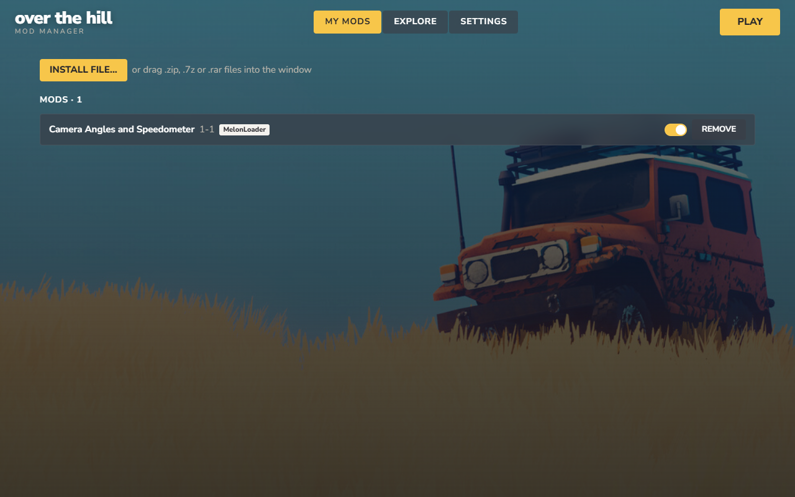

# OTH Mod Manager

A simple mod manager for [over the hill](https://store.steampowered.com/app/2929250). Unofficial community tool, not affiliated with or endorsed by Funselektor.




## Features

- **Drag and drop** a `.zip`, `.7z` or `.rar`: mods, BepInEx plugins and livery packs go to the right place.
- **Loaders handled for you**: when a mod needs MelonLoader or BepInEx, the app offers to install and activate it. Only one loader runs at a time.
- **Explore** the game's Nexus Mods inside the app, with search, a loader filter and Installed / Update available badges.
- **One-click install** with a Nexus account. Premium installs from the app. Free accounts use "Mod Manager Download" on the mod page (`nxm://` links), or "Manual Download" and drag the file in.
- **Dependency check** before installing a Nexus mod.
- Turn mods and liveries on or off, or remove them. Removing a mod deletes exactly the files it installed.
- Detects the Steam install automatically. English and Português (BR).

## Install

Download the installer from [Releases](../../releases) or from Nexus Mods. The installer is not code-signed, so Windows SmartScreen may warn you.

Requires Windows 10/11 with WebView2 (included in Windows 11) and the game on Steam.

## Nexus account

Settings → paste your personal API key (from <https://www.nexusmods.com/settings/api-keys>). The key is stored in plain text in the app's `settings.json` on your computer and is only sent to Nexus.

## Build from source

Needs Node 22+, Rust (stable) and the [Tauri 2 prerequisites](https://v2.tauri.app/start/prerequisites/).

```
npm ci
npm run tauri dev        # run
npm run check            # svelte-check
cargo test --manifest-path src-tauri/Cargo.toml
npm run tauri build      # NSIS installer in src-tauri/target/release/bundle/nsis
```

Stack: Tauri 2, SvelteKit 5, Rust. Game research notes are in [MODDING_PLAN.md](MODDING_PLAN.md).

Pushing a `v*` tag runs `.github/workflows/release.yml`, which builds a draft GitHub release.

## Credits

- Funselektor, for over the hill.
- LavaGang (MelonLoader) and the BepInEx team. The app downloads both from their official releases when a mod needs them.
- Nexus Mods, for the website and API.
- Tauri and Svelte.
- Nunito Sans by The Nunito Sans Project Authors, SIL Open Font License 1.1 (`src-tauri/licenses/NunitoSans-OFL.txt`).

## License

[MIT](LICENSE)
